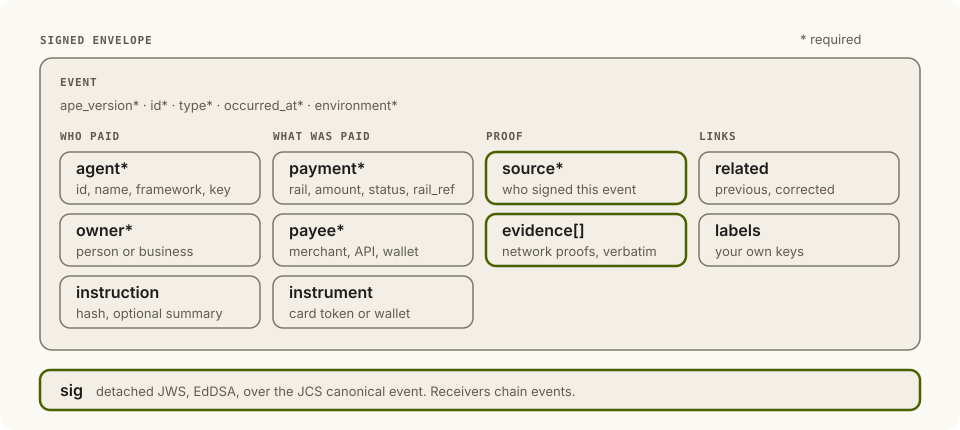

# Agent Payment Event (APE) v0.2

<p>
<a href="https://github.com/halvorAI/ape-schema/actions/workflows/conformance.yml"></a>
<a href="https://schema.halvorai.com/ape/v0.2.json"></a>
<a href="https://github.com/halvorAI/ape-schema/blob/main/LICENSE"></a>
<a href="https://github.com/halvorAI/ape-schema"></a>
</p>

An open, rail-neutral record of one AI agent payment: which agent paid, for whom, on whose instruction, on which rail, and the network proofs that came with it.

It's for anyone who produces or receives agent payment records: agent wallets, agent cards, agentic checkout, payment processors, and the risk and compliance teams at the banks behind them. It is not tied to HalvorAI; we want the schema to be shared.

<p align="center"></p>

Canonical URL: `https://schema.halvorai.com/ape/v0.2.json`. Source: [`ape/v0.2.json`](ape/v0.2.json). v0.1 stays published at `https://schema.halvorai.com/ape/v0.1.json`, and every v0.1 event is still valid.

**New in v0.2** (all optional; see [`CHANGELOG.md`](CHANGELOG.md)):
- **Who saw the payment.** An unknown owner type, `attribution_gaps` and `source.perspective`.
- **What it cost and bought.** `payment.payer_amount` and `payment.fees`, `payment.checkout_digest`, `payment.intermediary`, and `delivery`.
- **Matching runs.** A normalised instruction hash.
- **New evidence kinds.** `tool.response` and `chain.receipt`.
- **A new event.** `agent.reported`, for what the agent told its owner.

## Try it

Validate an example event against the published schema. You need Node.js 18 or later; there is nothing to clone:

```bash
curl -sO https://schema.halvorai.com/ape/v0.2.json
curl -sO https://raw.githubusercontent.com/halvorAI/ape-schema/main/examples/x402-settled.json
npx -y -p ajv-cli@5 -p ajv-formats@3 ajv validate --spec=draft2020 --strict=false -c ajv-formats -s v0.2.json -d x402-settled.json
```

```text
x402-settled.json valid
```

On Windows PowerShell, type `curl.exe` and `npx.cmd` in place of `curl` and `npx`.

Now break it: amounts are strings of minor or atomic units, never JSON numbers. Change `"value": "10000"` to `"value": 10000` in the file and run the last command again with `--errors=text`:

```text
x402-settled.json invalid
data/payment/amount/value must be string
```

<details>
<summary><b>The full example event</b> (x402, settled)</summary>

```json
{
  "ape_version": "0.1",
  "id": "evt_01JA8Q4K3T9V2C7M5N6P8R0S1W",
  "type": "payment.settled",
  "occurred_at": "2026-10-17T09:14:03.218Z",
  "environment": "test",
  "source": {
    "id": "src_01JA8P0Z6X1Y2Z3A4B5C6D7E8F",
    "sdk": "@halvorai/ingest@0.1.0",
    "adapter": "x402-client"
  },
  "agent": {
    "id": "agt_research_07",
    "name": "Market research agent",
    "framework": "openai-agents",
    "version": "2026.10.2",
    "key_thumbprint": "NzbLsXh8uDCcd-6MNwXF4W_7noWXFZAfHkxZsRGC9Xs"
  },
  "owner": {
    "id": "own_acme_ltd",
    "type": "business",
    "display_name": "Acme Analytics Ltd",
    "country": "US",
    "kyc_ref": "kyb_88231"
  },
  "instruction": {
    "id": "ins_5521",
    "hash": "sha256:f755e5bdab5721af297a47e30692f0b50c4abd68e52f711e1fe8b970aa4e5890",
    "summary": "Pull the latest EU power prices and summarise.",
    "channel": "chat",
    "issued_at": "2026-10-17T09:13:41.002Z",
    "tool_call_id": "call_x2b9"
  },
  "payment": {
    "payment_id": "x402:eip155:8453:0xf3746613c2d920b5fdabc0856f2aeb2d4f88ee6037b8cc5d04a71a4462f13480",
    "rail": "x402",
    "amount": {
      "value": "10000",
      "unit": "atomic",
      "asset": {
        "network": "eip155:8453",
        "address": "0x833589fCD6eDb6E08f4c7C32D4f71b54bdA02913",
        "symbol": "USDC",
        "decimals": 6
      }
    },
    "status": "settled",
    "description": "Premium market data, 1 request",
    "rail_ref": {
      "scheme": "exact",
      "network": "eip155:8453",
      "nonce": "0xf3746613c2d920b5fdabc0856f2aeb2d4f88ee6037b8cc5d04a71a4462f13480",
      "tx_hash": "0x1234567890abcdef1234567890abcdef1234567890abcdef1234567890abcdef",
      "facilitator": "https://x402.org/facilitator",
      "payment_flow": "authorization"
    }
  },
  "payee": {
    "type": "api_provider",
    "name": "Example Market Data",
    "wallet": {
      "network": "eip155:8453",
      "address": "0x209693Bc6afc0C5328bA36FaF03C514EF312287C"
    },
    "resource_url": "https://api.example.com/premium-data"
  },
  "instrument": {
    "type": "wallet",
    "wallet": {
      "network": "eip155:8453",
      "address": "0x857b06519E91e3A54538791bDbb0E22373e36b66"
    }
  },
  "evidence": [
    {
      "kind": "x402.settlement",
      "format": "json",
      "value": {
        "success": true,
        "transaction": "0x1234567890abcdef1234567890abcdef1234567890abcdef1234567890abcdef",
        "network": "eip155:8453",
        "payer": "0x857b06519E91e3A54538791bDbb0E22373e36b66"
      },
      "sha256": "sha256:0000000000000000000000000000000000000000000000000000000000000000"
    }
  ],
  "related": {
    "previous_event_id": "evt_01JA8Q4JZ0B1C2D3E4F5G6H7J8",
    "session_id": "ses_9f2"
  }
}
```

</details>

<details>
<summary><b>Validate in your own code</b> (Ajv)</summary>

```js
import Ajv2020 from 'ajv/dist/2020.js';
import addFormats from 'ajv-formats';
import schema from './ape/v0.2.json' with { type: 'json' };

const ajv = new Ajv2020({ strict: false });
addFormats(ajv);
const validate = ajv.compile(schema);

if (!validate(event)) console.error(validate.errors);
```

</details>

JSON Schema cannot express every rule. Receivers must also reject an event whose free-text fields contain a possible card number (a Luhn-valid run of 13 to 19 digits). [`docs/FIELDS.md`](docs/FIELDS.md#cross-field-rules) lists exactly which fields are free text.

## Run the conformance suite

[`conformance/`](conformance/) holds events every implementation must accept or reject, plus signing and canonical-JSON test vectors. SDKs and receivers should run them in their own tests.

```bash
git clone https://github.com/halvorAI/ape-schema && cd ape-schema
npm ci && npm test
```

```text
All 82 conformance checks passed.
```

## Design goals

1. Rail-neutral: one event shape for card, Stripe, x402, MPP, stablecoin and bank transfer payments.
2. Attributed: every event names the agent, the owner it acts for, and the instruction it acted on.
3. Evidence travels with the payment: network proofs are attached verbatim so any party can verify them later.
4. No spend limits of its own: mandate constraints come from the network credential.
5. Tamper-evident: producers sign each event; receivers chain them.
6. Privacy by default: instructions are a hash plus an optional redacted summary; card numbers never appear.

## Signing

An envelope is `{ "event": { ... }, "sig": "<detached JWS>" }`. The JWS header is `{"alg":"EdDSA","kid":"<source id>","typ":"ape+jws","ape":"0.2"}` (`ape` is the event's `ape_version`) and the payload is the RFC 8785 (JCS) canonical form of `event`, detached per RFC 7515 Appendix F.

<a name="validate-an-event"></a>

## Versioning

`ape_version` is `MAJOR.MINOR`. Minor versions only add optional fields, and receivers pick the schema by `ape_version`. Within a version, unknown top-level fields and unknown `rail_ref` keys are rejected; keys inside `labels` and `evidence[].value` are open, and receivers ignore the ones they do not use. v0.x may change between minors until v1.0.

The `sha256` values in the examples are placeholders; real events carry the digest of their evidence value.

## Choose your next step

| I want to | Read |
| --- | --- |
| Look up a field and its rules | [`docs/FIELDS.md`](docs/FIELDS.md), generated from the schema |
| Map my rail: AP2, Mastercard Verifiable Intent, Visa TAP, x402 v2, MPP or Stripe | [`docs/MAPPINGS.md`](docs/MAPPINGS.md) |
| Build an SDK that emits APE events (redaction, signing, delivery, spool) | [`docs/SDK.md`](docs/SDK.md) |
| See complete events: x402 settled, Stripe Issuing with AP2 and TAP, Stripe failed | [`examples/`](examples/) |
| Emit APE events from Node.js or Python today | [`@halvorai/ingest`](https://github.com/halvorAI/ingest-js), [`halvorai-ingest`](https://github.com/halvorAI/ingest-python) |
| Propose a field or a mapping | [Open an issue](https://github.com/halvorAI/ape-schema/issues) |

Projects that emit or accept APE events can show it with this badge:

```markdown
[](https://github.com/halvorAI/ape-schema)
```

## Contributing

Rail mappings, examples, conformance cases and doc fixes are welcome. [CONTRIBUTING.md](CONTRIBUTING.md) explains how to run the checks, what is in scope and how quickly we respond. Starter tasks are labeled [`good first issue`](https://github.com/halvorAI/ape-schema/labels/good%20first%20issue).

Questions and open design points go in the [issue tracker](https://github.com/halvorAI/ape-schema/issues). Report vulnerabilities privately; see [SECURITY.md](SECURITY.md).

## License

Apache-2.0. See [`LICENSE`](LICENSE).
