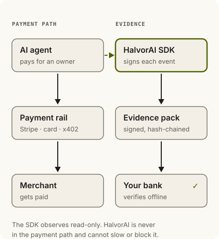

# README kit

Shared figures and conventions for the README of every public halvorAI repository. They live here because this repository is the neutral, rail-agnostic one, and it is already served at `schema.halvorai.com`.

## Hero figure

| File | Use |
| --- | --- |
| [`figures/hero-wide.svg`](figures/hero-wide.svg) | Screens 1012 px and wider |
| [`figures/hero-narrow.svg`](figures/hero-narrow.svg) | Phones and narrow panes |

Both follow the viewer's light or dark mode on their own. Edit [`figures/build.py`](figures/build.py) and run `python3 assets/figures/build.py` to regenerate them; don't edit the SVGs by hand.

Paste this under a README's title. It uses absolute URLs because the same README also renders on npmjs.com and pypi.org, where relative image paths break.

```html
<p align="center"><picture><source media="(min-width: 1012px)" srcset="https://raw.githubusercontent.com/halvorAI/ape-schema/main/assets/figures/hero-wide.svg"></picture></p>
```

## Badges

One row under the title, at 16 px, in this order: CI, version, downloads, license. Use shields.io `flat-square`.

```html
<p>
<a href="https://github.com/halvorAI/REPO/actions/workflows/ci.yml"></a>
<a href="https://www.npmjs.com/package/PACKAGE"></a>
<a href="https://github.com/halvorAI/REPO/blob/main/LICENSE"></a>
<a href="https://github.com/halvorAI/ape-schema"></a>
</p>
```

For PyPI use `https://img.shields.io/pypi/v/PACKAGE?style=flat-square&label=pypi&color=4A6100`. Frozen SDKs add `https://img.shields.io/badge/status-frozen-7A766C?style=flat-square`.

The "APE v0.1" badge is for any project, ours or not, that emits or accepts Agent Payment Events.

## Writing rules

- Say who it is for in one sentence near the top.
- Pin versions in every install command.
- After every command, show the output it prints in a `text` block.
- End with an "I want to | Read" table instead of a list of links.
- Use `<details>` for platform-specific or reference material that most readers skip.
- Use this positioning sentence, word for word: "HalvorAI records and proves agent payments after the fact. It is never in the payment path and cannot slow or block a payment." Use "record", "flag" and "evidence"; never "approve", "hold" or "block" for what HalvorAI does.
